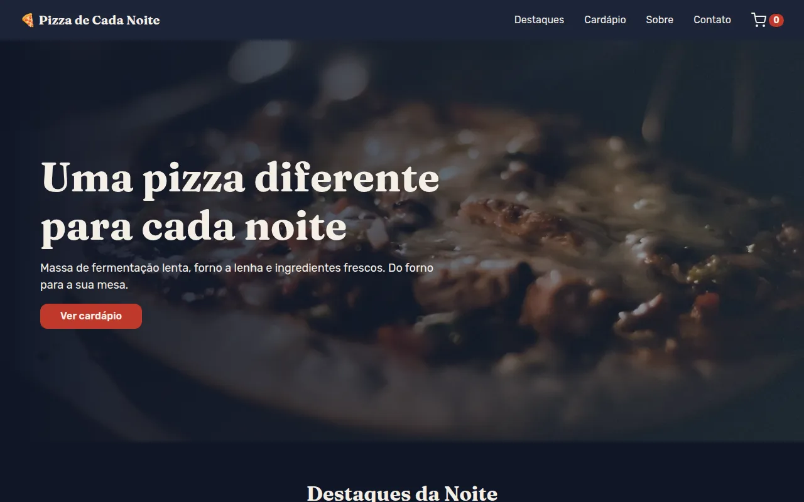
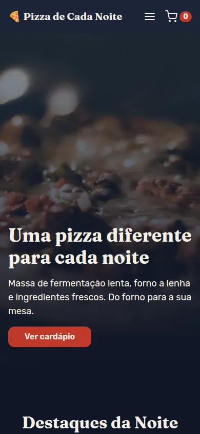

# 🍕 Pizza de Cada Noite

Site de uma pizzaria fictícia, feito com **HTML, CSS e TypeScript puro**, sem framework. O tema é noturno e aconchegante, com cardápio filtrável, carrinho lateral salvo no navegador e finalização de pedido simulada.

**🔗 Site no ar:** https://kuet1.github.io/PizzaDeCadaNoite/

<p align="center">
  
  
</p>

## Funcionalidades

- **Cabeçalho fixo** com links para as seções, contador do carrinho e menu hambúrguer no celular.
- **Carrossel "Destaques da Noite"** com `scroll-snap` (só CSS, sem biblioteca).
- **Cardápio com filtros** por categoria: Tradicionais, Especiais, Doces e Bebidas.
- **Carrinho lateral**: adicionar, aumentar/diminuir, remover e total. O conteúdo continua lá depois de recarregar a página (`localStorage`).
- **Finalizar pedido**: tela de confirmação e carrinho esvaziado (sem pagamento real).
- **Responsivo** (mobile first) e **acessível**: HTML semântico, navegação por teclado, `alt` nas imagens, contraste conferido (WCAG AA).

## Tecnologias

| Tecnologia | Uso |
|---|---|
| HTML semântico | Estrutura de página única (one-page); carrinho e confirmação em `<dialog>` |
| CSS puro | Variáveis no `:root`, mobile first, convenção BEM, Grid e Flexbox |
| TypeScript | Tipos do cardápio e do carrinho, renderização dos cards, estado do carrinho |
| Vite | Servidor de desenvolvimento e build |
| GitHub Actions + GitHub Pages | Deploy automático a cada push na `main` |

## Decisões técnicas

| Decisão | Por quê |
|---|---|
| Sem framework | Praticar a base (DOM, eventos, CSS) que os frameworks escondem |
| Preço em **centavos** (`number` inteiro) | Evita erro de arredondamento com decimais (`0.1 + 0.2 !== 0.3`); formatação com `Intl.NumberFormat` |
| Cards criados com `createElement` + `textContent` | Evita XSS, que poderia acontecer com `innerHTML` |
| Carrinho guarda só `id` + quantidade | O preço vem sempre do cardápio, então um valor alterado no `localStorage` não muda o total |
| *Type guard* ao ler o `localStorage` | Os dados salvos podem estar corrompidos ou ter sido editados; o que não passa na validação é descartado |
| Padrão *observer* (`onCartChange`) | O contador e o carrinho se atualizam sozinhos quando o estado muda |
| Delegação de eventos no carrinho | Um único listener para todos os botões, mesmo depois de redesenhar a lista |
| `<dialog>` + `showModal()` | Foco preso no modal, `Esc` para fechar e acessibilidade nativa do navegador |
| Hero fixo em vez de carrossel | Carrossel no topo costuma esconder conteúdo e prejudicar a experiência |
| Fotos em WebP | ~416 KB no total para as 10 fotos |
| `base: "./"` no Vite | O GitHub Pages publica o site numa subpasta (`/PizzaDeCadaNoite/`) |

## Como rodar

```bash
git clone https://github.com/Kuet1/PizzaDeCadaNoite.git
cd PizzaDeCadaNoite
npm install
npm run dev       # servidor de desenvolvimento
npm run build     # checa os tipos (tsc) e gera a pasta dist/
npm run preview   # serve o dist/ para testar o build
```

## Estrutura

```
src/
├── components/   # funções que criam o HTML (card, carrinho, filtros, menu)
├── data/         # cardápio tipado
├── services/     # estado do carrinho + localStorage
├── styles/       # variables.css, reset.css, main.css
├── types/        # interfaces e tipos
└── utils/        # formatação de preço
```

## Como usei IA neste projeto

Este é um dos 5 sites que eu precisava entregar em uma semana. Usei o **Claude Code** como par de programação e mudei a forma de trabalhar no meio do caminho:

| Fase | Como foi |
|---|---|
| **Modo aprendizado** (configuração, variáveis CSS, reset) | Eu escrevia o código; a IA explicava os conceitos e revisava |
| **Modo acelerado** (a partir do HTML) | A IA escrevia o código em blocos; eu revisava, testava no navegador e aprovava cada etapa antes do commit |

**O que eu fiz:**
- Defini o escopo, a direção visual e o que ficou de fora (carrossel com botões, modal de tamanhos) para cumprir o prazo.
- Revisei cada bloco e pedi explicação de tudo que era novo para mim até conseguir explicar com minhas palavras.
- Escolhi as fotos e testei o site no navegador e no celular.

**O que eu aprendi sobre usar IA:**
- Além de ganhar tempo, a IA me ajudou a entender conceitos que eu ainda não conhecia bem.
- Precisei ficar atento aos recursos nativos do navegador que eu não conhecia (`<dialog>`, `Intl.NumberFormat`, `localStorage`, delegação de eventos) e à estrutura do HTML, pedindo explicação até entender.
- No próximo projeto, quero acompanhar mais de perto cada passo e ser mais rígido com o que aceito no código. Neste, sinto que não prestei atenção o suficiente em tudo.

## Créditos das fotos

- **Unsplash:** Md Mahdi (hero), Fabrizio Pullara (forno), Aldward Castillo (margherita e pizza de chocolate), Husien Bisky (pepperoni), NHXL BDL (rúcula), Amadeus Moga (cogumelos).
- **Pexels:** Visão Produções (frutas), Ron Lach (refrigerante), Mohamed (limonada).

---

Projeto de portfólio. A pizzaria, o endereço e os contatos são fictícios.
